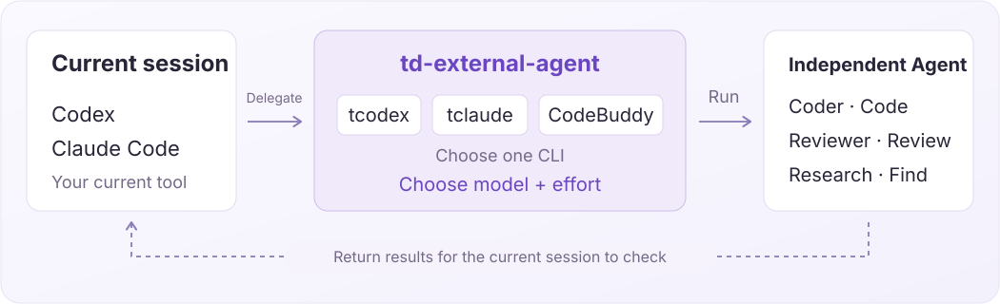

<p align="right">English | <a href="README.zh-CN.md">中文</a></p>

# td-external-agent

**Use other AI coding CLIs as your independent agents.**

Supports **CodeBuddy, tcodex and tclaude**. Choose a model and effort level for coding, reviews or research.

[](assets/agent-overview.en.svg)

## 1. Getting started

Install in your project directory:

```bash
npx skills@latest add YangZhaoWeblog/skills-common --skill td-external-agent -y
```

**Use an external agent as your Coder**

```text
$td-external-agent

Use <tcodex> as the Coder to implement the approved Plan and add tests. Report the results when finished.
Use model <model ID> and effort <high>.
```

**Ask another agent for an independent review**

```text
$td-external-agent

Use <tclaude> as the Reviewer to review the current changes without modifying files. Report findings with code locations.
Use model <model ID> and effort <high>.
```

**Save a role without running a task**

```text
$td-external-agent

Configure <tclaude> as the project's Coder for future use. Do not run a task now.
Use model <model ID> and effort <medium>.
```

Both execution and saving need `<CLI, Model, Effort>`. If any value is missing, the Skill asks you first.

## 2. Save as a project role

Configure a role upfront or save it after a task, then reuse it in your project.

> Save this invocation as the project's Coder? I will add the role configuration and an entry point, recording tcodex, `<model ID>` and high for future use.

**Before saving, the agent shows the files and changes, then waits for your approval before writing.**

If you choose not to save, it skips this step and will not ask again in this conversation.
