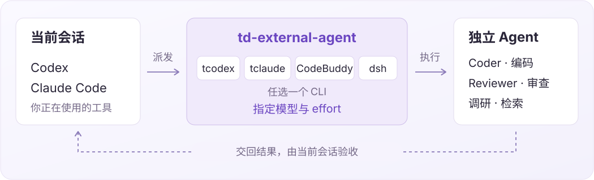

<p align="right">中文 | <a href="README.md">English</a></p>

# td-external-agent

**把其他 AI Coding CLI，当作你的独立 Agent。**

支持 **CodeBuddy、tcodex 和 tclaude**，可指定模型和 effort，用于编码、审查或调研。

[](assets/agent-overview.svg)

## 一、快速开始

在项目目录安装：

```bash
npx skills@latest add YangZhaoWeblog/skills-common --skill td-external-agent -y
```

**把外部 Agent 当 Coder**

```text
$td-external-agent

用〈tcodex〉作为 Coder，按已批准的 Plan 编码并补测试，完成后报告。
模型用〈模型 ID〉，effort 用〈High〉。
```

**让另一个 Agent 独立审查**

```text
$td-external-agent

用〈tclaude〉作为 Reviewer，只读审查本次改动，完成后报告问题和代码位置。
模型用〈模型 ID〉，effort 用〈High〉。
```

**只保存角色，暂不执行**

```text
$td-external-agent

把〈tclaude〉配置为项目 Coder，供以后使用，现在不执行任务。
模型用〈模型 ID〉，effort 用〈Medium〉。
```

执行或保存前都要明确 `<CLI, Model, Effort>` 三项；缺少任何一项，Skill 会先问你。

## 二、保存为项目角色

可以提前配置角色，也可以用过再保存，下次直接复用。

> 要把这次调用保存为项目里的 Coder 吗？我会一并添加角色配置和调用入口，记录 tcodex、〈模型 ID〉和 High，之后可直接复用。

**保存前，先展示要修改的文件和内容，得到你同意后再写入。**

不想保存就跳过，本次对话不再问。
