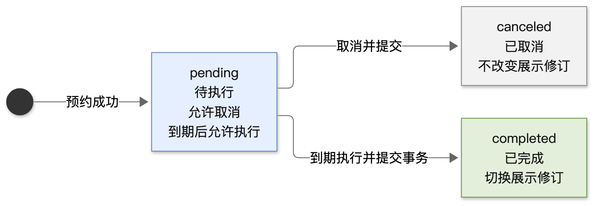

# 领域模块变更设计范例（虚构）

**案例性质：** 以下是为展示技术文档写法而独立构造的知识库修订与定时发布案例。表、接口、结构、规则和流程均为虚构，不对应真实项目，也不是原系统的逐项改名版本。

**使用方式：** 迭代型文档可直接复制骨架、标题、表头和变更标签，再按实际任务调整。采用前仍需确定骨架和每节的表达；调研型、DB 调研型及其他场景可另定结构。示例展示必要信息的密度与组合，不规定章节数、接口数或图数。

## 一、背景

**修订发布模块**为虚构知识库提供预约、取消与到期应用规则。应用层负责时间获取、持久化及事务，模块根据输入对象产生目标结果，不访问队列或数据库。



图源：[发布任务状态图 Mermaid 源码](../../assets/examples/article-lifecycle.mmd)。文章展示版本的切换只发生在任务完成时。

## 二、数据结构设计

### 2.1 数据结构定义

以下定义给出本例方法使用的完整业务类型；错误通过 **error** 返回。示例采用 Go 结构与签名表达契约，不提供完整实现。

```go
type Article struct {
	ID               string `json:"id"`
	Title            string `json:"title"`
	ActiveRevisionID string `json:"activeRevisionId"` // 空串表示尚未发布
}

type Revision struct {
	ID        string `json:"id"`
	ArticleID string `json:"articleId"`
	Body      string `json:"body"`
	CreatedAt int64  `json:"createdAt"` // Unix 秒
}

type ReleaseJob struct {
	ID         string `json:"id"`
	ArticleID  string `json:"articleId"`
	RevisionID string `json:"revisionId"`
	ExecuteAt  int64  `json:"executeAt"` // Unix 秒
	State      string `json:"state"`     // pending / completed / canceled
	Version    int64  `json:"version"`
}

type ScheduleInput struct {
	JobID     string `json:"jobId"`
	ExecuteAt int64  `json:"executeAt"`
	Now       int64  `json:"now"`
}

type ApplyResult struct {
	Article Article    `json:"article"`
	Job     ReleaseJob `json:"job"`
}
```

**持久化与模块类型的空值表示不同：** 数据库的 **article.active_revision_id = NULL** 对应模块中的空串；应用层负责转换，空串不是一条真实修订的编号。

### 2.2 变更说明

| 类型、字段 | 变更类型 | 变更内容 |
| --- | --- | --- |
| **Article.ActiveRevisionID** | 新增 | 表达当前展示版本，与最新编辑版本分离。 |
| **Article.Body** | 删除 | 正文转入不可变的 **Revision.Body**；文章对象只保存展示指针。 |
| **Revision** | 新增 | 修订归属文章，创建后不再覆盖。 |
| **ReleaseJob** | 新增 | 固定目标修订、执行时间、任务状态与版本。 |
| **ScheduleInput** | 新增 | 显式传入任务编号、计划时间与当前时间，模块自行校验未来时间。 |
| **ApplyResult** | 新增 | 同时返回待保存的文章和任务；应用层在同一事务内保存二者。 |

## 三、模块方法设计

### 3.1 方法定义

```go
Schedule(article Article, revision Revision, input ScheduleInput) (ReleaseJob, error)
Cancel(job ReleaseJob, expectedVersion int64) (ReleaseJob, error)
Apply(article Article, revision Revision, job ReleaseJob, now int64) (ApplyResult, error)
```

### 3.2 变更说明

| 模块方法 | 变更类型 | 输入约束与行为 | 输出 |
| --- | --- | --- | --- |
| **Schedule** | 新增 | 修订必须归属文章，编号非空，执行时间晚于当前时间；不修改文章展示指针。 | **pending** 任务，**Version = 1**。 |
| **Cancel** | 新增 | **expectedVersion** 必须相符；仅 **pending** 转为 **canceled**。已取消且版本相符时返回原任务；已完成时拒绝取消。 | 变更时版本加一；不修改文章。 |
| **Apply** | 新增 | 校验文章、修订与任务的关联。任务已完成或已取消时返回输入状态；待执行且到期时更新展示指针并完成任务；未到期时返回输入状态。 | **ApplyResult**；发生变更时任务版本加一。 |
| **ReplaceBody** | 方法删除 | 旧的就地正文覆盖入口移除；保存新内容改为新增修订，由应用层持久化。 | — |

**模块结果不等于持久化成功。** 执行器在事务内依次锁定文章和任务后读取所需输入，调用模块并保存结果，提交成功后才向上游返回完成。对已完成任务重复调用时，不把文章指针重新改回该任务的旧修订。

应用层与模块的调用、受理和提交边界见配套服务端范例；无需在两篇文档重复绘制同一执行时序。
