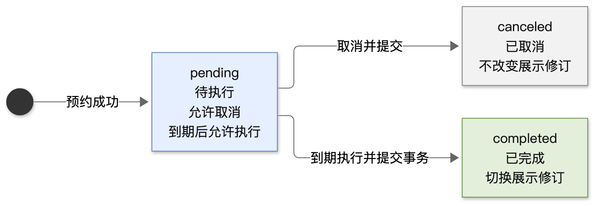
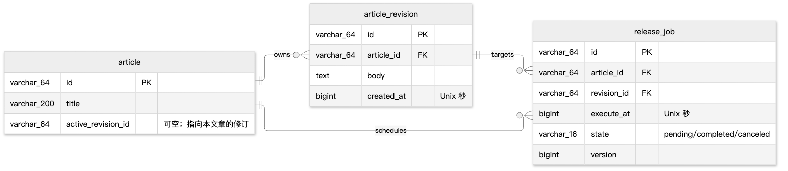
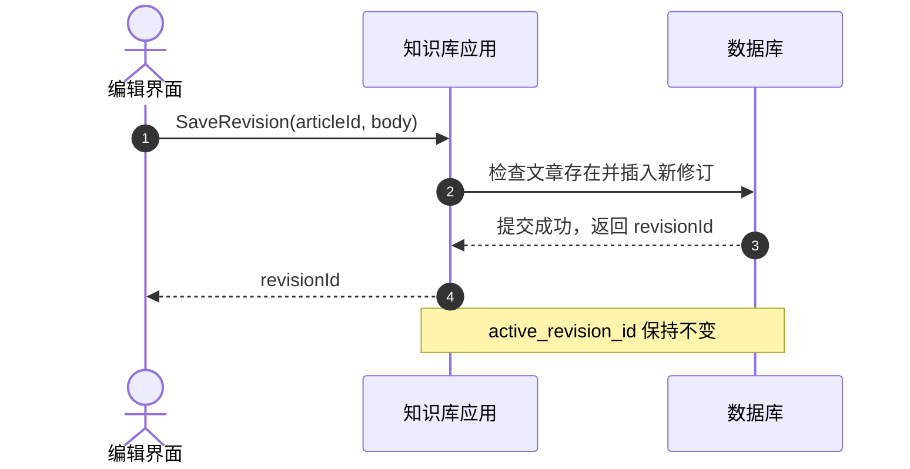
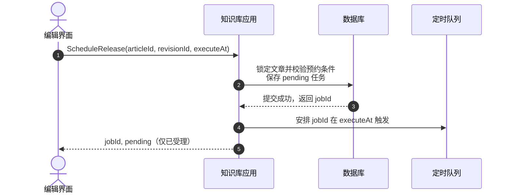
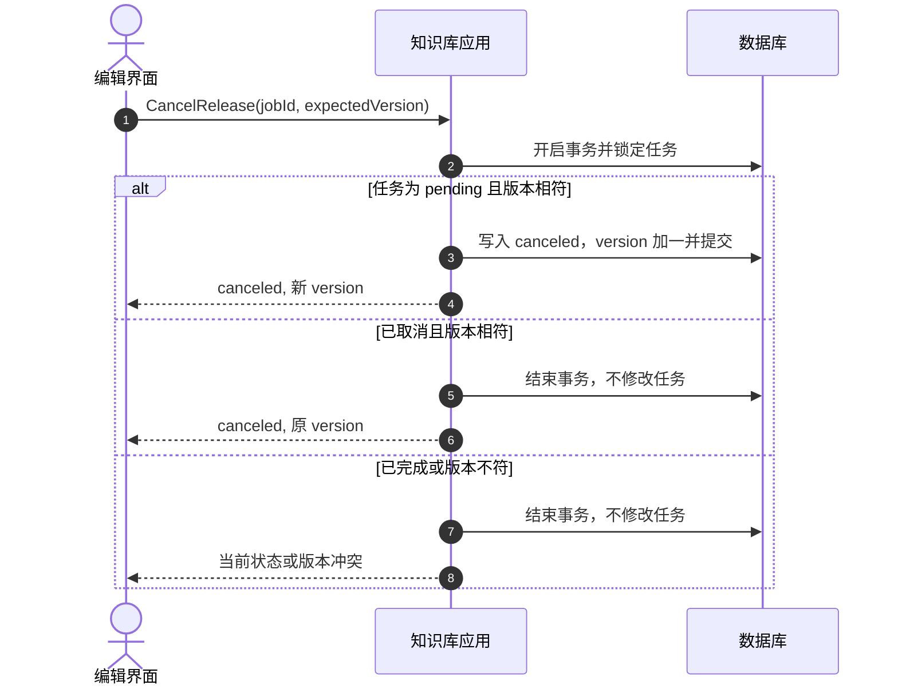
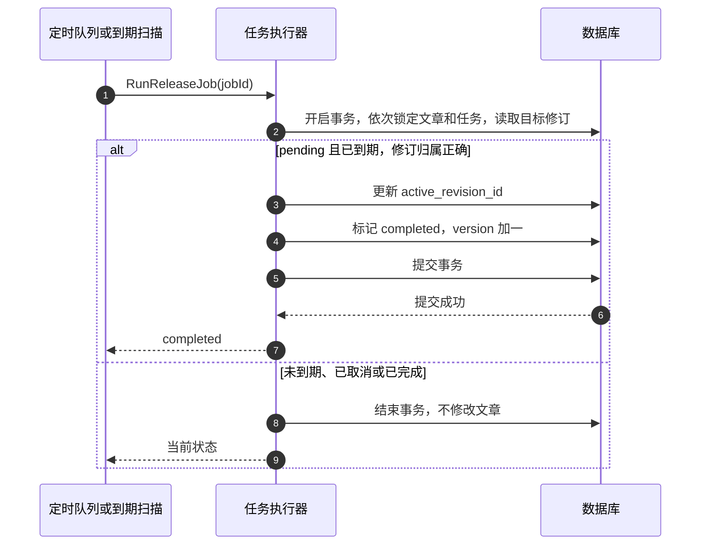

# 服务端变更设计范例（虚构）

**案例性质：** 以下是为展示技术文档写法而独立构造的知识库修订与定时发布案例。表、接口、结构、规则和流程均为虚构，不对应真实项目，也不是原系统的逐项改名版本。

**使用方式：** 迭代型文档可直接复制骨架、标题、表头和变更标签，再按实际任务调整。采用前仍需确定骨架和每节的表达；调研型、DB 调研型及其他场景可另定结构。示例展示必要信息的密度与组合，不规定章节数、接口数或图数。

## 一、背景

知识库新增**不可变修订与定时发布**。编辑内容生成新修订，已展示的内容保持不变；到达计划时间后才切换当前展示版本。

**虚构需求：** 编辑者可预约和取消发布，阅读者始终读取最后一次成功发布的修订。本例仅定义应用接口、数据变化和定时执行流程。

图源：[发布任务状态图 Mermaid 源码](../../assets/examples/article-lifecycle.mmd)。任务状态与文章是否已有展示版本相互独立；预约和取消不改变当前展示内容。

## 二、库表变更

图源：[修订与发布任务关系图 Mermaid 源码](../../assets/examples/article-schema.mmd)。图中 **varchar_64** 等表示字段类型 **varchar(64)**；关系表示数据关联。

| 表 | 变更类型 | 变更内容 |
| --- | --- | --- |
| **article** | 修改 | 新增可空的 **active_revision_id**，指向当前展示修订；文章尚未发布时为空。删除原 **body**，正文归属修订记录。 |
| **article_revision** | 新增 | 保存 **id、article_id、body、created_at**。修订一经创建不再修改；保存编辑内容新增一条修订。 |
| **release_job** | 新增 | 保存 **id、article_id、revision_id、execute_at、state、version**。状态取 **pending、completed、canceled**；**version** 用于检测并发修改。 |

**同一文章最多存在一个 pending 发布任务。** 预约事务先锁定文章，再检查是否已有待执行任务；到期执行也按文章、任务的顺序加锁。

**article_revision.article_id 与 release_job.article_id 必须相符。** 发布任务固定指向创建任务时选定的修订，后续编辑不会改变任务内容。文章的 **active_revision_id** 必须指向本文章的修订。

迁移时将原正文写成首个修订，并使已有展示内容的文章指向该修订，确认迁移结果后移除原正文列。具体脚本由实际项目定义；此处不提供可直接执行的迁移命令。

## 三、接口变更

### 3.1 前后端接口变更说明

| 接口 | 变更类型 | 请求变更 | 响应变更 | 备注 |
| --- | --- | --- | --- | --- |
| **CreateArticle** | 语义调整 | 保留 **title、body** | 新增 **revisionId** | 创建文章及首个修订，不立即发布。 |
| **SaveRevision** | 新接口 | **articleId、body** | **revisionId** | 返回新增修订编号，已有展示内容保持不变。 |
| **GetArticleInfo** | 响应字段新增 | — | 新增 **activeRevisionId、latestRevisionId** | 编辑界面区分已展示版本和最新编辑版本。 |
| **ListArticles** | 响应字段新增 | — | 列表项新增可空的 **activeRevisionId** | 与详情中的同名字段含义一致。 |
| **ScheduleRelease** | 新接口 | **articleId、revisionId、executeAt** | **jobId、state** | 只受理未来时间；返回 **pending** 不代表已发布。 |
| **CancelRelease** | 新接口 | **jobId、expectedVersion** | **state、version** | **pending** 可取消；已取消且版本相符时返回原状态；版本不符时冲突，**completed** 拒绝。 |
| **GetReleaseJob** | 新接口 | **jobId** | **revisionId、executeAt、state、version** | 调用方据任务状态确认结果，不据预约请求成功判断已发布。 |
| **UpdateArticleBody** | 接口删除 | — | — | 编辑统一改用 **SaveRevision**，不再覆盖原正文。 |

时间字段采用 **Unix 秒**。“—”表示没有对应字段变化；新增接口已在表中给出本例所需字段，实际项目还需定义通用响应封装和错误码。

### 3.2 内部接口变更说明

| 接口 | 变更类型 | 请求变更 | 响应变更 | 备注 |
| --- | --- | --- | --- | --- |
| **ReadLiveArticle** | 语义调整 | — | 正文来自 **active_revision_id** 指向的修订 | 尚无展示版本时返回未发布，不回退到最新编辑内容。 |
| **RunReleaseJob** | 新接口 | **jobId** | **state**；完成时含 **revisionId** | 仅处理到期任务；重复执行已完成或已取消任务时只返回当前结果。 |

## 四、核心流程变化

### 4.1 保存修订

**保存只新增修订，不切换阅读版本。** 文章不存在时拒绝保存。

### 4.2 预约发布

**任务固定绑定所选修订。** 应用在事务内锁定文章、检查没有待执行任务并保存新任务，再通知定时队列；队列作为到期执行入口。通知失败时仍可从到期任务扫描恢复；队列消息本身不作为完成依据。

### 4.3 取消预约

**取消和到期执行通过同一条任务记录竞争。** 应用在事务内锁定任务，检查版本并取消；执行端也必须在锁定文章后锁定该记录。哪个事务先完成，就以其提交结果为准。

队列中残留的触发消息无需依赖即时撤回：执行端重新读取任务状态后跳过已取消任务。

### 4.4 到期执行与阅读

**切换当前修订和标记任务完成在同一数据库事务中提交。** 任务未到期或不再是待执行状态时，不改变文章；事务失败时维持原展示修订及待执行状态，由重试或到期扫描再次处理。修订归属校验失败时返回错误，不修改文章和任务。

阅读接口按 **active_revision_id** 读取正文，因此事务提交前仍显示旧版本，提交后才显示新版本。任务失败不等于文章失去已有展示内容。
